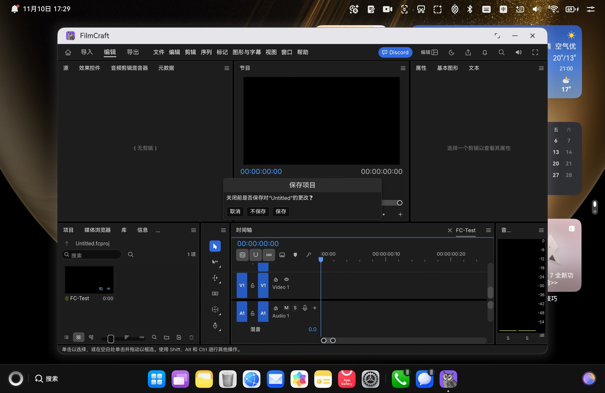
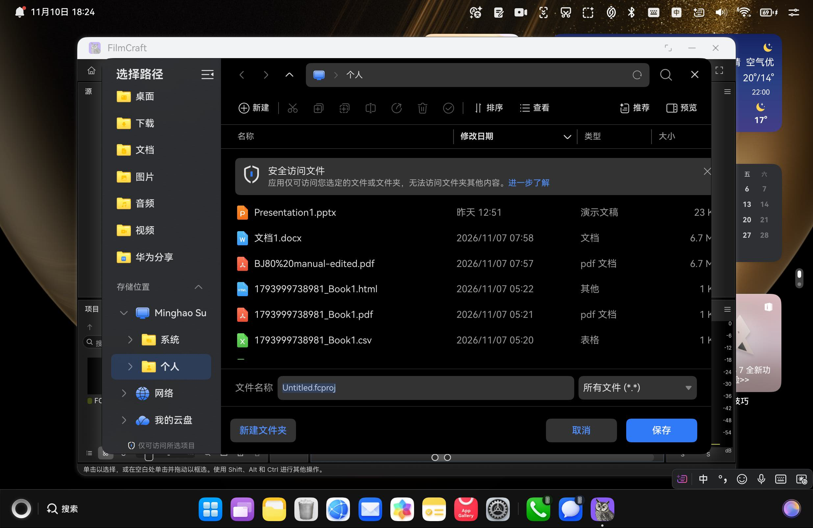

# FilmCraft for HarmonyOS

把 [FilmCraft](https://github.com/storytold/filmcraft)（纯 Rust + egui 的视频剪辑器）移植到 **HarmonyOS**，产出可在真机安装运行的 DevEco Studio 工程与签名 `.hap`。

- **移植对象**：`storytold/filmcraft` workspace `0.17.0`，上游源码以 path 依赖方式引入，**不 patch 上游**
- **应用标识**：显示名 `FilmCraft`；`versionName` `0.17.0`、`versionCode` `1700`；`bundleName` `io.github.shaliuxin.filmcraft.hmos`
- **目标平台**：HarmonyOS 6 / API 26 / aarch64（真机 HPR-W72，2in1 PC，设备 `46G0225429001073`）
- **交付包**：`entry/build/default/outputs/default/entry-default-signed.hap`（本轮 116,317,280 字节）


---

## 架构（三层）

```
ArkTS (UIAbility + XComponent, libraryname:'filmcraft')
   │  N-API (libfilmcraft.so: init/input/reply/open/drop/attach/resize/detach/frame/active/close/command)
   ▼
C++ N-API 桥 (entry/src/main/cpp/bridge.cpp, napi module "filmcraft")
   │  链接 libfilmcraft_hmos.a
   ▼
Rust 适配层 (native/rust, staticlib "filmcraft_hmos")
   │  path 依赖上游 crates
   ▼
FilmcraftApp (crates/ui-egui) + filmcraft_engine::Session
```

渲染走 **wgpu GLES 后端直绘鸿蒙 `NativeWindow`**，不经 eframe / winit 事件循环。宿主每帧构造 `egui::RawInput`、驱动 `app.logic()` + `app.ui()`，并把 `platform_output` 里的 IME、URL、Viewport 命令翻译成 ArkTS 能力。

界面中文来自上游源码树内嵌的 `crates/ui-egui/src/i18n/zh-cn.tsv`（`ui-egui/build.rs` 读取），不依赖 `CRAFT_I18N_DIR`。

---

## 功能与状态

如实区分「真机已验证」与「本轮未覆盖」。

| 能力 | 状态 | 说明 |
| --- | --- | --- |
| aarch64 Rust 静态库 → CMake 链接 → HAP 打包签名 | ✅ 已验证 | `build_native.sh` + `hvigor assembleHap` BUILD SUCCESSFUL，`SignHap` 通过 |
| 真机安装 / 启动 / 持续渲染 | ✅ 已验证 | `hdc install -r` → `aa start`；GPU 合成器持续出帧，进程稳定无 crash |
| 全中文界面 | ✅ 已验证 | 菜单（导入/编辑/导出/文件/序列/标记/图形与字幕/视图/窗口/帮助）、监视器、面板、时间轴、状态栏，无方块乱码 |
| 中文输入法（IME） | ✅ 已验证 | 透明锚点 `requestFocus` → `attach(true, textConfig)` → attach 成功后绑定 `insertText` 等回调 → `showTextInput`；宿主按 `platform_output.ime` 显隐键盘；无 12800003 / 12800009 / 201 |
| **关闭窗口保存确认** | ✅ 已验证 | 点标题栏 X 弹出「保存项目／关闭前是否保存对"Untitled"的更改？」三按钮（取消／不保存／保存）；「取消」保留窗口与工程；「不保存」正常 `app exit` 退出，无崩溃 |
| 引擎命令通道 | ✅ 已验证 | 22 条命令覆盖项目／选择／剪贴板／标记／播放头／序列／历史／偏好等子系统，17 条成功、5 条返回预期内的参数校验错误，零崩溃 |
| 菜单下拉 / 面板标签交互 | ✅ 已验证 | 9 个顶部菜单全部展开（中文、禁用置灰、快捷键、子菜单箭头正常），9 个面板标签切换生效，全程零崩溃 |
| 保存按钮 → picker → 写盘 | ✅ 已验证 | 脏工程点 X →「保存」→ 系统「选择路径」对话框（文件名自动填 `Untitled.fcproj`）→ 确认后写入 3402 字节工程文件 → 对话框消失 → 正常 `app exit`。日志链路 `saveproject → savebytes → wrote 3402 bytes` |
| 打开项目 / 导入媒体 | ✅ 已验证 | `openproject`、`openmedia` 均正确唤起系统选择器；点「取消」后 `native.reply` 正常回包，worker 不阻塞，UI 继续响应（菜单可再次展开） |
| 其它文件类请求 | ✅ 已验证 | `Index.ets` 补齐 `openfile`／`relink`／`saveas`／`pickfolder`／`pickfolderat`／`openurl`／`openpath` 分支，并为未知 kind 加兜底回包；全程日志无 `unsupported` |
| 导出大视频 | ⚠️ 部分 | 通过 `Services::export_in_memory` 让导出字节走同一 `savebytes` 通道，但大文件（内存编码 + NAPI 字节传输）尚未真机验证 |
| x86_64 产物 | ⚠️ 本轮未验证 | 本轮只编译 aarch64（真机所需 ABI） |





---

## 关闭确认的实现

系统关窗会直接销毁窗口、绕过宿主，因此三层协作拦截：

1. **ArkTS**：`EntryAbility.onWindowStageCreate` 注册 `mainWindow.on('windowWillClose', async (): Promise<boolean> => …)`，回调返回 `true` 拦截并调用 `native.close()`。SDK 26 要求 `Promise<boolean>`；写成同步 `(): boolean` 会报 `10505001 No overload matches this call`。
2. **C++ / Rust**：`wc_close()` → `Message::Close`；下一帧向 egui 注入 `ViewportEvent::Close`。
3. **上游**：`FilmcraftApp::logic_control` 检测 `viewport().close_requested()`，脏工程时 `panels::clip_dialogs::intercept_quit` 弹出保存确认并发出 `ViewportCommand::CancelClose`；用户选 Save / Don't Save 后 `leave()` 置 `quit_confirmed` 并发出 `ViewportCommand::Close`。
4. **宿主 `close_action()`** 只看这两个命令：`CancelClose` → 暂缓关闭（继续绘制对话框）；`Close` → 下一帧重新注入关闭事件再验；无 `CancelClose` → `notify("close")` 通知 ArkTS `terminateSelf()`。

这套机制与姊妹工程 `deckcraft-hmos` 的关窗守卫一致；它依赖上游的 `ViewportCommand`，而不是 `WordApp` 那种 `app.close_requested()` 私有方法。

---

## 文件 IO 宿主缝

上游 FilmCraft 用的是 `HostHooks`（picker 返回**路径字符串**）+ `filmcraft_engine::Services`（`read_file` / `write_file`），
与 WordCraft / DeckCraft 的 `Services::host_save` 并不是同一套接口，鸿蒙侧这样对接：

- `native/rust/src/lib.rs` 把 `OhosServices` 注入 `Session::new()`：`config.files` 沙箱内的路径（autosave、预设、
  媒体缓存）交给原生 `FsServices` 静默写入；用户文档路径则发 `bridge::request("savebytes", path, bytes)`，
  由 ArkTS 弹 `DocumentViewPicker.save` 取得授权 URI 后写盘。上游 `write_project` 正是走 `services.write_file`，
  所以保存 / 另存 / 导出都自动落到这条通道。
- `Index.ets` 的 `receive()` 逐一接收 `HostHooks` 发出的 10 个 kinds：`openmedia`（多选，回 JSON 数组路径）、
  `openproject` / `openfile` / `relink`（单选，复制进 `.inbox` 回真实路径）、`saveproject` / `saveas`（只回建议名，
  不弹第二次 picker）、`pickfolder` / `pickfolderat`（回沙箱可写目录）、`openurl` / `openpath`。
- `bridge::request` 是**阻塞等 `native.reply`** 的，因此所有分支（含未知 kind 的兜底）都必须回包；
  否则 Rust worker 会永久卡在系统选择器上。这一条是该移植最容易踩的坑。

---

## 构建与安装

需要 DevEco Studio（含 OpenHarmony native SDK）、Rust `aarch64-unknown-linux-ohos` target，以及连接好的真机。

```bash
# 1) 还原本机真实签名配置（公开仓库里的是占位符版）
cp signing/build-profile.local.json5 build-profile.json5

# 2) 编译 Rust 适配层（只编真机所需 ABI）
export FC_NATIVE_SDK="/c/Program Files/Huawei/DevEco Studio/sdk/default/openharmony/native"
export FC_NATIVE_TARGETS="aarch64-unknown-linux-ohos"
bash scripts/build_native.sh

# 3) 打包签名 HAP
node "<DevEco>/tools/hvigor/bin/hvigorw.js" assembleHap --mode module \
  -p product=default -p buildMode=debug --no-daemon

# 4) 安装并启动
hdc install -r entry/build/default/outputs/default/entry-default-signed.hap
hdc shell aa start -a EntryAbility -b io.github.shaliuxin.filmcraft.hmos
```

`build_native.sh` 在 Windows 上会用无空格 junction `C:\ohosnative` 绕开 `C:\Program Files` 的路径空格问题。

---

## 签名说明

本仓库的 `build-profile.json5` 是**占位符版**（`signingConfigs: []`），真实证书路径与口令 hex 不入库。本机真实配置保存在 `signing/build-profile.local.json5`（该目录已被 `.gitignore` 屏蔽）。

首次使用请在 DevEco Studio 里用本项目**专属** `bundleName` 做一次自动签名，生成绑定自己设备 UDID 的调试 Profile。**切勿复用其它 craft 工程的 bundleName 或签名 Profile**：Profile 与 bundleName + 设备 UDID 绑定，复用会与该包名已装的旧 App 撞车（真机报 `9568263 版本降级`），且包名上架后永久不可改。

---

## 许可与上游

移植工程沿用上游的 **Apache-2.0 OR MIT** 双许可，许可证全文见 [`LICENSE-APACHE`](./LICENSE-APACHE) 与 [`LICENSE-MIT`](./LICENSE-MIT)。

上游项目：ArtCraft Team and the FilmCraft contributors, *filmcraft*, GitHub, <https://github.com/storytold/filmcraft>, workspace version 0.17.0.

---

## ⭐ OHOS 平台判定与资源探测必查（2026-11-11 全项目强制）

> 本节是**跨项目强制条款**，源自 PhotoCraft v0.22.0 的严重缺陷「打开照片报内存不足，只有很小的图片能打开」。
> 权威版见《craft-鸿蒙移植通用检查清单》文首 ⭐ 铁律与 §18。新项目开工、每次上游升级后必须逐项打勾。

**一眼判据**：编译、链接、启动全绿，只有稍大的数据失败，且报错里出现 `0.0 GB is free`、
`0 bytes available`、`0 cores`、`limit 0` 这类**零值** → 先怀疑「资源探测器读不到 → fail-closed 返回 0」，
不要当成真的资源不足，也不要先猜「文件太大 / ArkTS 缓存 / fd 读取」。

**根因**：OHOS triple（`*-unknown-linux-ohos`）仍报告 `target_os = "linux"`。上游凡靠
`#[cfg(target_os = "linux")]` 分派的 Linux 专属逻辑（cgroup / procfs / 内存探测 / 字体路径 / `dlopen` /
系统目录）在鸿蒙应用沙箱里都会被误用。PhotoCraft 的通用 Linux 探测器要求 cgroup v1 挂载带 `memory`
controller 名，而 OHOS 把 memory 控制器挂在 `/dev/memcg`、`mountinfo` 不含 controller 名，应用进程读
`/dev/memcg` 与 `/proc/<pid>/root/sys/fs/cgroup` 均为 `Permission denied`；探测器因此返回
`available_ram = Some(0)`，图片导入准入 `check_fits()` 把每张稍大的照片判成内存不足，真机报错原文是
`not enough memory to open this 6000 × 4000 px image: it needs about 0.1 GB and 0.0 GB is free`
（该设备 `/proc/meminfo` 实际有约 22.2 GiB 可用）。

**本项目自检清单（开工 / 每次上游升级后）**：
- [ ] `grep -rn 'target_os = "linux"\|cfg(unix)' <上游>/crates`，逐个判断平台假设在 OHOS 沙箱里是否成立；重点查「读取系统资源上限」类代码（内存、CPU、磁盘、cgroup、rlimit）。
- [ ] OHOS 专用分支只用 `#[cfg(target_env = "ohos")]`；真正的 Linux 分支写成 `#[cfg(all(target_os = "linux", not(target_env = "ohos")))]`，且 OHOS 交叉编译不得有该模块的 dead_code 警告。
- [ ] 探测器「测不到」必须返回 `UNKNOWN`（让上游走未知资源的保守策略），**绝不返回 `Some(0)`**。
- [ ] 只用沙箱真正可读的数据源（`/proc/meminfo` 的 `MemAvailable`），按单应用口径保守封顶；不要把整机 RAM 原样交给单个任务；由系统管理的 swap/zram 记 0。
- [ ] 平台修复做成独立 numbered patch + `target_env = "ohos"` 分支 + `#[cfg(any(target_env = "ohos", test))]` 的主机可跑纯函数单测，保证上游升级只冲突一个 hunk。
- [ ] 真机前后对照：构造「文件小、解码内存大」的样本，先在旧包复现报错，再 `hdc install -r -d` 覆盖安装验证；不能只跑 `cargo check` / 单测就宣布修好。

> 出处（MLA）：「⭐ OHOS 平台判定与资源探测铁律」与「§18. PhotoCraft 追加经验」，
> *craft-鸿蒙移植通用检查清单.md*, 本地工作区 `C:/Users/mingh/WorkBuddy/2026-11-01-23-18-01/`,
> 11 Nov. 2026. 修复实例见 PhotoCraft `patches/0005-ohos-memory.patch` 与
> `upstream/photocraft/crates/raster/src/memory/system.rs`。

---

## ⭐ 关窗保存确认必查（2026-11-11 全项目强制）

> 本节是**跨项目强制条款**，源自「点系统窗口 X / 返回手势不弹『是否保存』对话框、未保存改动静默丢失」
> 这一**数据丢失级缺陷**。权威版见《craft-鸿蒙移植通用检查清单》文首 ⭐ 关窗保存确认铁律（12 项）、
> §8、§15 / §15.1 / §15.2 与 §19 全项目落地登记。新项目从骨架阶段、每次上游升级后按序打勾。

**为什么最容易漏**：关闭链路跨 ArkTS 拦截层、Rust 逻辑相帧顺序、上游「允许关闭」信号三层，
任一层缺失都能编译通过、正常启动、hilog 甚至全绿，但点 X 就是不弹框。VectorCraft v0.23.0
连续修了两次才闭环——首版只接通道，用户复测仍是「直接关掉、不弹框」。

**现象 → 断点速判**：点 X 直接退出且无日志 → ArkTS 没订阅窗口级关窗事件；
拦到了却静默关窗 → Rust `tick` 在 `run_ui` pass 外 / 「无 CancelClose」被误判成「无未保存」；
弹框但选完保存或丢弃窗口不关 → 没锁存本上游的允许关闭信号；
框根本画不出来 → 关窗时窗口失焦、`active=false` 让 Frame 分支提前返回。

**本项目必查清单（骨架 → 交付，缺一项不算闭环）**：
- [ ] **1. 先查本上游用什么表达「可以关窗」，绝不照抄兄弟工程字段**：
      `grep -rn "close_requested\|allow_close\|quit_requested\|ui.status\|CancelClose\|quit_confirmed" <上游>/apps <上游>/crates`。
      GridCraft 用 `SheetApp::allow_close`；WordCraft 用 `close_requested()` + `quit_requested`；
      VectorCraft 没有 `allow_close`，靠 `unsaved::close_all(app, "quit")` 写 `app.ui.status = "quit"`；
      FilmCraft / DeckCraft 用 `intercept_quit()` 发 `CancelClose`，作答后 `quit_confirmed` + `Close`。
- [ ] **2. ArkTS 只订阅一个窗口级关窗事件**：`EntryAbility.onWindowStageCreate` 里
      `getMainWindowSync().on('windowWillClose', async (): Promise<boolean> => …)`。SDK 26 契约：
      `return true` = 拦截（窗口保留）、`false` / reject = 放行；写成同步 `(): boolean` 会报
      `10505001 No overload matches this call`。别同时注册 `windowStageClose` / `onPrepareToTerminate`
      （优先级冲突，见 §8）；WordCraft 的 `windowStageClose` 是另一套已验证写法，照抄前先核 SDK 声明。
- [ ] **3. 回调内直连、无条件拦截**：`native.close(); return true;`，**不要** `closeGuard.ets` 那种跨模块
      单例回调（多一层「两文件是否共享同一模块实例」的不确定性，见 §15.2）。Rust 确认后由页面
      `receive('close')` → `terminateSelf()`，该路径不会再触发 `windowWillClose`，无需「已确认放行」标志。
- [ ] **4. 返回手势也要消费**：`onBackPress()` 转发 Escape（键码 2070）并 `return true`，
      否则返回手势直接销毁页面，同样绕过未保存确认。
- [ ] **5. 头号根因：Rust `editor_frame` 把 `tick` / `finish_ime_logic` 放进 `ctx.run_ui` 的 pass 内、
      `ui()` 之前**，用 `current_pass_index() == 0` 防多 pass 重复。只要上游 logic 读 `ctx.input()`
      （`close_requested` / `focused` / zoom / viewport）就必须如此：pass 外只能读上一帧 input，
      `ViewportEvent::Close` 当帧不可见 → 上游不发 `CancelClose` → 宿主误判「无未保存」→ 静默关窗（§15.1）。
      对照物：eframe `App::logic`、web shell `logic`、GridCraft `editor_frame` 三者顺序一致。
- [ ] **6. 关窗判定不能反向推断**：`CancelClose` 优先暂缓（等用户作答）；**绝不**把「本帧没有
      `CancelClose`」当成「无未保存」直接 Confirm；锁存第 1 项查到的允许关闭信号后放行一次，
      加 `terminating` 防重复 `notify("close")`。用户点 Cancel 时上游不发信号、窗口自然保留。
- [ ] **7. 关窗期间强制出帧**：`Message::Close` 里 `active = true; bridge::resume()`，
      Frame / vsync 请求 / repaint 排帧的 active 判断在校验期间放行（`active || close`）。
      否则系统 X 先触发 `onBackground → active(false)`，保存框永远画不出来。
- [ ] **8. 三段诊断日志**：`system X forwarded` → `saveChanges pending, window kept` →
      `confirmed, notifying host`（Rust `bridge::notify(0,"diagnostic",…)` + ArkTS `console.info`），
      真机点一次 X 就能从 hilog 读出全链路，无需合成输入。
- [ ] **9. 构建与包内校验**：`cargo check` → 双 ABI release → `assembleHap` → 包内 ArkTS 字节码含
      `windowWillClose`、`.so` 含三段诊断文案 → `hdc install -r -d` 覆盖安装；别只改源码就宣布修好。
- [ ] **10. 真机三态人工验收不可省**：制造未保存改动 → 点 X → **亲眼看到**「是否保存」框；
      分别试 Save / Don't Save / Cancel，前两者应出现 `confirmed, notifying host` 且窗口关闭，Cancel 保留。
- [ ] **11. 验收判据写进移植报告**：`RegisterListener: [windowWillClose, 1]` 只证明**监听器注册**，
      **不等于修好**；必须有用户真机点 X 的实证日志 / 截图才算闭环。VectorCraft 首版正是栽在这里。
- [ ] **12. 多窗口 2-in-1 设备不发合成点击**：合成点击会被误路由并改动邻窗
      （VectorCraft 曾在 GridCraft 单元格误写 `7`），此项一律请用户手点。

> **升级 / 回归**：上游大版本升级可能改宿主帧顺序或允许关闭字段名，按第 1、5、6 项重新 `grep`，
> 再跑一次第 10 项三态验收。
>
> 出处（MLA）：「⭐ 关窗保存确认铁律」与「§15. 关窗保存守卫」，
> *craft-鸿蒙移植通用检查清单.md*, 本地工作区 `C:/Users/mingh/WorkBuddy/2026-11-01-23-18-01/`,
> 10–11 Nov. 2026.
